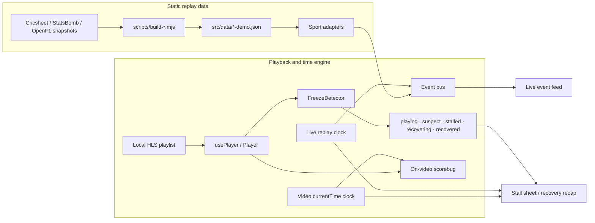

# KeepAlive

KeepAlive is a mobile-first demo for keeping a fan in the match when a video stream
freezes. The local video and the match-event replay are independent: the video
can stop while the compact event feed keeps moving, then a recap shows what
happened before playback returns.

**Stack:** Vite, React, TypeScript, hls.js, CSS, Vitest, Playwright, and
Lighthouse. The site builds to static files; the app makes no runtime API calls
and requires no keys or paid services.

## Architecture



### Responsibilities

- `src/ui/App.tsx` selects a sport, publishes its local events on the event bus,
  advances the live replay clock, and connects the player, feed, and Director’s
  panel.
- `src/ui/Player.tsx` owns the player wrapper and chrome. `src/engine/usePlayer.ts`
  attaches hls.js to the local VOD playlist, reports playback metrics, and
  injects a real network interruption by stopping HLS loading. Native HLS uses
  a clearly labeled simulated fault path.
- `src/engine/freezeDetector.ts` is framework-free. Video events, a 500 ms
  playback watchdog, HLS stall errors, and online/offline events feed its state
  machine. It debounces short stalls and confirms recovery only after playback
  progress.
- `src/engine/clocks.ts` keeps the live replay clock independent from
  `video.currentTime`. The scorebug follows the video clock; the event feed
  follows the live clock; their difference determines the missed-event recap.
- `src/data/adapters.ts` gives Cricket, Football, and F1 the same `Event[]`
  interface and renderer contract. Each sport imports generated JSON, never a
  runtime service.
- `src/ui/MatchExperience.tsx` renders the shared stall sheet and recap. It
  shows the frozen score alongside the live score, feed activity, missed key
  events, follow controls, offline state, and recovery actions.

### Project map

```text
src/
  data/       shared event types, adapters, generated replays, source snapshots
  engine/     clocks, event bus, freeze detector, player hook, unit tests
  ui/         app shell, video player, event glyphs, stall sheet and recap
  style.css   design tokens, responsive layout, player and state styling
scripts/      data builders, one-time OpenF1 downloader, HLS and bundle tools
public/media/ local HLS playlist/segments, poster, and credited StatsBomb mark
tests/e2e/    Chromium mobile-viewport product flows
```

## Run locally

```sh
npm install
npm run dev
```

Open the local Vite URL. The stadium loop and replay data are served from the
project. If the browser blocks muted autoplay, press **Tap to start**.

## How to test the freeze yourself

1. Open the app in Chromium and press **Tap to start** if autoplay is blocked.
2. Wait for the player controls, then scroll to the Director’s panel.
3. Press **Break the network**; the video stops while the event feed continues.
4. Press **Restore** and check the recap chips against the missed event list.
5. Press **Jump to live** to return to the current replay position.

## Checks

```sh
npm run build
npm test
npx playwright install chromium
npm run test:e2e
npm run check:bundle
```

The Playwright suite uses Chromium at a 390 × 844 viewport and covers video
start, a real HLS network break, event delivery during the stall, recap counts,
a 1.5-second stutter, offline state, and fullscreen overlay visibility. Vitest
covers clocks, missed-event selection, the event bus, and detector timelines.
The bundle check reports gzip JavaScript size excluding the separate hls.js
chunk.

For a mobile Lighthouse run, start the production preview first:

```sh
npm run build
npm run preview -- --host 127.0.0.1 --port 4173
```

Then, in another terminal, run `npm run audit:lighthouse`. The report is written
to `artifacts/lighthouse-mobile.json`.

## Replay data and credits

### Cricket

The Cricket replay is normalized from the Cricsheet India–South Africa 2024 T20
World Cup final JSON at `src/data/raw/1415755.json`:

```sh
npm run build:cricket
```

Cricsheet data is available under the
[Open Data Commons Attribution License](https://cricsheet.org/licensing/).

### Football

The Football replay uses StatsBomb’s open-data Argentina–France 2022 World Cup
final match file. StatsBomb is credited in the UI and its mark is included in
the source panel. The source match JSON and license are in `src/data/raw/`; the
mark is in `public/media/credits/`.

```sh
npm run build:football
```

See [StatsBomb Open Data](https://github.com/hudl/open-data) and the
[StatsBomb logo-use guide](https://statsbomb.com/wp-content/uploads/2023/03/StatsBomb_LogoUseGuide_MediaPack-min.pdf).

### F1

The F1 replay is a static snapshot of OpenF1’s 2023 British Grand Prix race
session. The four downloaded datasets—race control, pit stops, laps, and
positions—are saved under `src/data/raw/f1-9126/`. The app reads the generated
JSON only; it does not call OpenF1 at runtime.

```sh
npm run download:f1 # optional one-time snapshot refresh
npm run build:f1
```

Source: [OpenF1 documentation](https://openf1.org/docs/).

### Video

The local six-minute HLS loop uses a royalty-free stadium clip from
[Pexels](https://www.pexels.com/video/aerial-view-of-live-cricket-match-in-a-stadium-18148072/)
by Hindustani Lens. The source clip and its credit are in `scripts/assets/`.
Regenerate the HLS files with `scripts/build-hls.sh` and ffmpeg. See the
[Pexels license](https://www.pexels.com/license/).

## Deployment

Vercel builds `npm run build` and serves the static `dist/` directory.
`vercel.json` sets the HLS playlist MIME type (`application/vnd.apple.mpegurl`),
MPEG-TS segment MIME type (`video/mp2t`), and explicit cache headers for HLS
media and self-hosted fonts.

## Future improvements

- Add visual regression screenshots for 390 px, tablet, and desktop layouts,
  including each playback state and reduced-motion mode.
- Run a deployment smoke check against a Vercel preview URL to verify playlist
  and segment MIME types and cache headers at the CDN edge.
- Expand adapter fixtures for rare event cases and proofread the marked Hindi
  templates with a fluent speaker before presenting them as finished copy.
- Exercise network interruption at multiple buffer depths and across native HLS
  browsers, alongside the existing Chromium flow.

## Author

CharanAdithya6505
