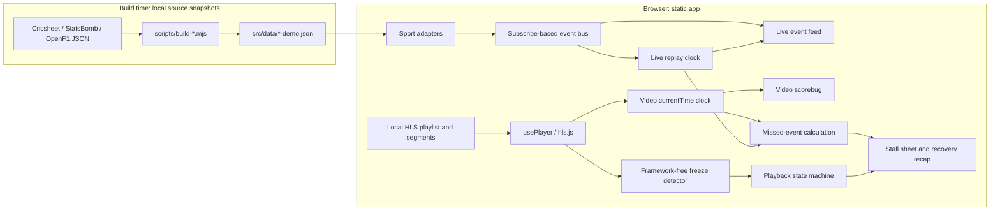

# KeepAlive

**A match should not disappear when its video does.** KeepAlive is a mobile-first
web demo for live sports viewing through a video interruption. When playback
freezes, a compact event feed keeps the fan in the match. When the picture
returns, a recap shows what happened and lets the viewer catch up to the replay
or keep watching from the frozen moment.

This is a static, frontend-only prototype. Each sport has its own local HLS
match clip; events are deterministic replays generated from real historical
match data. The video and event timelines are illustrative and are not
synchronized to one another.
There is no backend, runtime sports-data API, paid service, or API key.

## Product brief

### Problem

When a live stream stalls, fans often leave the player to look up the score and
key events elsewhere. That breaks the viewing experience and risks missing the
moment the stream recovers.

### Hypothesis

Match events are small compared with video. A lightweight event channel can
continue to explain the match while video is unavailable. A recovery recap can
then account for the gap between the match and the picture.

### Unique selling points

- **Two independent timelines:** match replay time continues while video time
  stops. KeepAlive can show both the live score and the score frozen into the
  picture.
- **Useful through an interruption:** a thresholded detector ignores brief
  stutters; important events continue to arrive in the feed.
- **A precise hand-back:** recap content is derived from events between the video
  and live clocks. The viewer chooses whether to stay behind or jump to live.
- **Visible bandwidth trade-off:** Two Lines contrasts video bitrate and event
  feed bytes using measured values.
- **Honest demo behavior:** historical event data is credited; the looped video
  and injected network fault are identified as demo behavior.
- **Multi-sport foundation:** Cricket, Football, and F1 share one event shape and
  adapter contract.

## What the demo does

1. Plays a six-minute, 480p local HLS loop of cricket, football, or Formula 1
   footage, selected with the sport switcher.
2. Confirms sustained stalls after three seconds to avoid popup flicker.
3. Advances the match event replay independently from video playback.
4. Shows a docked player sheet with the live score, latest event, recent feed,
   stall timer, and bandwidth comparison. The frozen scorebug stays tied to the
   video position.
5. Confirms recovery only after two seconds of smooth playback.
6. Builds a recap from missed key events, with counts, a key-moment highlight,
   and a compact timeline.
7. Offers **Keep watching from here** and **Jump to live**.
8. Handles browser-offline state while the replay clock continues.

The sport switcher sits directly above the player on every viewport. A
player-adjacent **Break the network** action makes the primary demo interaction
available on mobile without opening the Director’s panel. The panel holds the
5/10/20-second auto-restore setting, playback speed, replay restart, player
following, event-feed detail mode, and EN/Hindi selection. On a first visit, a
visible 25-second countdown offers **Skip auto stall**; if the viewer takes no
action, one scripted stall starts automatically.

The event feed is generated from local historical match data and does not
connect to a live event channel. The UI labels it **LOCAL REPLAY** and reports
the local replay clock instead of implying a network connection. Video clips
are illustrative and not synchronized with match events. The offline card also
explains that local replay continues while live delivery is not connected.

## Screenshots

Before/after audit captures are in [`artifacts/ui-audit/`](artifacts/ui-audit/)
for 390px, 768px, and 1280px widths and the idle, playing, suspect, stalled,
offline, recovering, recap, and fullscreen states. See
[`artifacts/ui-audit/audit.md`](artifacts/ui-audit/audit.md) for the defect
notes and changes.

## System architecture



### Runtime layers

| Layer | Location | Responsibility |
| --- | --- | --- |
| App shell | `src/ui/App.tsx` | Selects sport, advances the demo clock, and connects player, feed, recap, and Director’s panel. |
| Player | `src/ui/Player.tsx`, `src/engine/usePlayer.ts` | Loads local HLS, owns controls and metrics, and exposes break/restore/jump controls. |
| Freeze detection | `src/engine/freezeDetector.ts` | Framework-free state machine driven by media events, a 500ms watchdog, HLS stall errors, and online/offline events. |
| Clocks and event bus | `src/engine/clocks.ts`, `src/engine/eventBus.ts` | Keeps live and video time separate, publishes replay events, and selects missed events. |
| Adapters and data | `src/data/adapters.ts`, `src/data/*-demo.json` | Normalizes each sport to one event contract and renders sport-specific text and icons. |
| Match experience | `src/ui/MatchExperience.tsx` | Renders stall sheet, offline card, followed-player markers, language choice, and recovery recap. |
| Visual system | `src/style.css` | Design tokens, typography, responsive layout, player states, and reduced-motion behavior. |

### Playback and freeze state

The player uses hls.js where supported, with a small playback buffer. A network
break stops HLS loading; the decoded buffer drains and the media element stalls
naturally. Restore resumes loading from the saved video position. If hls.js is
not supported but native HLS is available, fault injection is labeled
**simulated**. Unsupported and playback-error states have visible messaging.

```text
playing -> suspect -> stalled -> recovering -> recovered -> playing
              |           ^          |
              +-> playing +----------+
```

A suspect stall must last 3 seconds before the sheet appears. Playback must
advance smoothly for 2 seconds before recovery is confirmed. Repeated stall
signals are debounced into one record with timestamps, cause, and clock
snapshots. Pausing or seeking is not treated as a stream failure.

### Clock and recap model

- `liveClock` is elapsed demo match time and continues regardless of video.
- `videoClock` is the media element’s `currentTime`.
- `lag = liveClock - videoClock`.
- The scorebug is built from events at or before `videoClock`.
- The feed is built from events at or before `liveClock`.
- `missed` is the difference between those sets, filtered to importance 2 or 3.
- `jumpToLive()` seeks to the live replay position, wrapping at local video
  duration when needed.

## Event data and sport adapters

Built-in replays use a shared `MatchEvent` shape:

```ts
type MatchEvent = {
  id: string;
  t: number; // seconds on the compressed demo timeline
  sport: 'cricket' | 'football' | 'f1';
  type: string; // sport-specific event type
  importance: 1 | 2 | 3;
  score: {
    runs: number;
    wkts: number;
    overs: string;
    display?: { label: string; value: string; context: string };
  };
  players: string[];
  text: { en: string; hi: string };
  bytes: number; // serialized event length estimate
};
```

The adapter contract is `Adapter { load(): Event[]; render(event): { text,
icon, importance } }`. Build scripts turn saved source snapshots into compact,
deterministic replays on an approximately six-minute timeline. Event text is
template-driven; there are no runtime LLM or network calls. Hindi template
strings are marked for proofreading.

| Sport | Checked-in source | Event focus | Builder |
| --- | --- | --- | --- |
| Cricket | Cricsheet India–South Africa 2024 T20 World Cup final, `src/data/raw/1415755.json` | Wickets, boundaries, milestones, over summaries, and selected ball events. Dot balls and singles are flood-controlled. | `npm run build:cricket` |
| Football | StatsBomb Argentina–France 2022 World Cup final, `src/data/raw/statsbomb-3869685.json` | Goals, saved shots, cards, substitutions, penalties, and VAR events when present. | `npm run build:football` |
| F1 | OpenF1 2023 British Grand Prix session 9126, `src/data/raw/f1-9126/` | Race control and flags, pit stops, top-five position changes, fastest lap, and retirements. | `npm run build:f1` |

The OpenF1 downloader is an **optional one-time snapshot refresh**. The
browser loads generated static JSON only; it never calls Cricsheet, StatsBomb,
or OpenF1.

### Data and media credits

- **Cricket:** [Cricsheet](https://cricsheet.org/), under the
  [Open Data Commons Attribution License](https://cricsheet.org/licensing/).
- **Football:** [StatsBomb Open Data](https://github.com/hudl/open-data).
  StatsBomb is credited in the UI and its supplied mark is in
  `public/media/credits/`. See the
  [logo use guide and media pack](https://statsbomb.com/wp-content/uploads/2023/03/StatsBomb_LogoUseGuide_MediaPack-min.pdf).
- **F1:** [OpenF1](https://openf1.org/docs/), saved as local JSON snapshots.
- **Cricket video:** Hindustani Lens’ royalty-free stadium clip from
  [Pexels](https://www.pexels.com/video/aerial-view-of-live-cricket-match-in-a-stadium-18148072/).
  Source media and credits are recorded in `scripts/assets/CREDITS.md`; see
  the [Pexels license](https://www.pexels.com/license/).
- **Football video:** Tio Nazih’s [Football Match on Stadium](https://www.pexels.com/video/football-match-on-stadium-11918917/)
  clip from Pexels; see the [Pexels license](https://www.pexels.com/license/).
- **Formula 1 video:** Rubin16’s [2021 Russian Grand Prix warm-up start](https://commons.wikimedia.org/wiki/File:2021_Russian_Grand_Prix_-_start_for_warm-up.webm)
  clip from Wikimedia Commons, licensed CC BY-SA 4.0. Attribution and the
  share-alike license for the adapted HLS version are documented in
  `scripts/assets/CREDITS.md`.

## Quick start

Requirements: Node.js 18 or newer and npm. Install Playwright Chromium only to
run browser tests. ffmpeg and ffprobe are needed only to regenerate HLS video.

```sh
git clone https://github.com/cax6505/KeepAlive.git
cd KeepAlive
npm ci
npm run dev
```

Open the Vite URL printed in the terminal. If browser autoplay is blocked, press
**Tap to start**. No API keys or environment variables are required.

## How to use the demo

1. Start playback. The sport switcher and controls sit directly above and
   below the video; the Director’s panel is beside it on desktop and below the
   match on a phone.
2. Optionally set auto-restore to 5s, 10s, or 20s.
3. Press the player-adjacent **Break the network** action (or the same control
   in the Director’s panel). The buffer drains; then the stall sheet appears
   while the local event replay advances.
4. Read the latest event, recent feed, live score, and Video/Feed traces. Choose
   **Tell me everything** or **Tell me when it’s back** for the sheet detail.
5. Press **Restore** if auto-restore is disabled. Review the recap once smooth
   playback is confirmed.
6. Choose **Keep watching from here** to remain behind or **Jump to live** to
   seek to the current replay time.

To see the offline card, start a stall and choose **Network > Offline** in
browser DevTools. Restore the connection to let the player recover. The local
replay clock and events continue offline; this demo has no live event delivery.

### Five-line freeze test

1. Open KeepAlive in Chromium; press **Tap to start** if needed.
2. Optionally set auto-restore to 20s in the Director’s panel.
3. Press the in-player **Break the network** action and wait for the picture to
   freeze.
4. Confirm the event feed advances; press **Restore**.
5. Review the recap, then choose **Jump to live** or **Keep watching from here**.

## Development and checks

| Command | Purpose |
| --- | --- |
| `npm run dev` | Start Vite development server. |
| `npm run build` | Type-check and build the static site into `dist/`. |
| `npm test` | Run Vitest engine unit tests. |
| `npm run test:e2e` | Build and run the Chromium Playwright suite. |
| `npm run check:bundle` | Report gzipped app JS size, excluding the separate hls.js chunk. |
| `npm run audit:lighthouse` | Audit preview at `http://127.0.0.1:4173`. |
| `npm run build:cricket` | Rebuild Cricket data from checked-in Cricsheet JSON. |
| `npm run build:football` | Rebuild Football data from checked-in StatsBomb JSON. |
| `npm run download:f1` | Optional one-time OpenF1 snapshot download. |
| `npm run build:f1` | Rebuild F1 data from the local snapshot. |

Run the test suites with:

```sh
npx playwright install chromium
npm test
npm run test:e2e
npm run check:bundle
```

Vitest covers clock selection, missed-event calculation, event-bus subscriptions,
and freeze-detector timelines (micro-stutter, sustained stall, flapping, offline
cause, and recovery). Playwright runs Chromium at 390 × 844 and covers video
start, a real HLS break, events during a stall, recap counts, 1.5-second
stutter, offline card, and fullscreen overlay.

For Lighthouse, run the production preview in one terminal:

```sh
npm run build
npm run preview -- --host 127.0.0.1 --port 4173
```

Then, in another terminal, run `npm run audit:lighthouse`. The report is written
to `artifacts/lighthouse-mobile.json`. The checked-in Lighthouse artifact is a
point-in-time report; rerun the audit after changes to measure the current
build. The latest bundle check recorded 101.63 KiB gzip for application
JavaScript, with hls.js reported separately.

## Repository map

```text
src/
  data/
    raw/               Checked-in source snapshots and license files
    *-demo.json        Generated normalized sports replays
    adapters.ts        Shared sport adapter contract and implementations
    types.ts           Shared sports/event types
  engine/
    clocks.ts          Live/video clocks and event selection
    eventBus.ts        Subscribe-based event publisher
    freezeDetector.ts  Framework-free stall state machine
    usePlayer.ts       HLS lifecycle, metrics, and fault controls
    *.test.ts          Vitest unit tests
  ui/
    App.tsx            App shell and state coordination
    Player.tsx         Video wrapper, chrome, and scorebug
    MatchExperience.tsx Stall sheet and recovery recap
  style.css            CSS tokens and responsive design system
scripts/
  build-*.mjs          Static event-data builders
  download-f1.mjs      Optional one-time OpenF1 downloader
  build-hls.sh          Local video-to-HLS generation
  check-bundle.mjs      Compressed application bundle budget
public/
  media/               HLS playlist, segments, poster, attribution mark
  fonts/               Self-hosted UI, display, and mono fonts
  sw.js                Same-origin shell/resource cache
tests/e2e/              Playwright product flows
artifacts/              UI audit screenshots and Lighthouse report
```

## Regenerating the video

The HLS playlists and segments are checked in under `public/media/`. To
regenerate the default Cricket clip, install ffmpeg/ffprobe and run:

```sh
bash scripts/build-hls.sh
```

By default, the script reads `scripts/assets/pexels-cricket-18148072.mp4` and
outputs a six-minute, 480p HLS VOD loop with two-second segments. It calculates
the loop count from the source clip duration. Rebuild the other sports with:

```sh
bash scripts/build-hls.sh scripts/assets/pexels-football-11918917.mp4 public/media/football
bash scripts/build-hls.sh scripts/assets/2021-russian-grand-prix-warmup.webm public/media/f1
```

The sport switcher selects the matching video. None of the clips is
synchronized to the historical event timestamps; the app identifies them as
illustrative replay footage.

## Deployment and offline behavior

KeepAlive is a static Vite site. Vercel builds with `npm run build` and publishes
`dist/`. [`vercel.json`](vercel.json) sets explicit MIME types and cache headers
for the HLS playlist, MPEG-TS segments, and WOFF2 fonts. The service worker
caches same-origin resources as requested, so resources already visited may be
available on a later offline visit. It does not guarantee that every video
segment has been cached in advance.

Another static host can serve the site if it preserves the Vite SPA fallback and
serves `.m3u8` as `application/vnd.apple.mpegurl` and `.ts` as `video/mp2t`.
Review cache policy if HLS filenames become mutable instead of versioned.

## Current scope and limitations

- This demonstrates replay behavior, not production live-stream integration.
  The player uses a local VOD loop and historical event timelines.
- The match clock is deterministic replay time; it is not synchronized to a
  real fixture or event provider.
- On hls.js browsers, the break stops segment loading and lets the small buffer
  drain. Native HLS platforms use a labeled simulated fault path.
- Offline behavior depends on the service worker being installed and requested
  same-origin resources being cached; full-match video is not pre-cached by
  guarantee.
- Hindi strings are template drafts and need fluent proofreading before wider
  use.
- Event byte counts estimate serialized event size. They exclude transport,
  protocol, compression, and connection overhead of a production channel.
- The demo has no authentication, profiles, cross-device settings, real-time
  messaging, or analytics collection.

## Future scope

### Product and playback

- Replace the local loop with an authorized live stream and reconcile video and
  event clocks against the platform timeline or program date-time.
- Connect a production lightweight event channel with replay/reconnect,
  sequencing, deduplication, and an explicit stale-data state.
- Test interruption and recovery across buffer depths, browsers, networks, and
  native HLS implementations.
- Validate screen-reader announcements, keyboard use, reduced motion, and
  contrast in every state with moderated mobile usability sessions.

### Data and personalization

- Add schema/version validation and builder fixtures for abandoned matches,
  extra innings, VAR reversals, and incomplete timing data.
- Have a fluent Hindi reviewer proofread templates; add locales only with
  maintained translations.
- Persist followed players and preferred feed mode in an explicit profile or
  local settings layer.
- Tune event importance and feed filters based on what fans need during stalls.

### Reliability and delivery

- Add visual-regression coverage for mobile, tablet, desktop, fullscreen, and
  reduced-motion states.
- Add CI checks for deterministic data builds, bundle size, accessibility, and
  HLS MIME/cache headers on a deployed preview.
- Measure real payload and transport overhead before making production
  bandwidth claims.
- Add an explicit offline-download experience if full-match replay availability
  is a product requirement.

## Author

CharanAdithya6505
